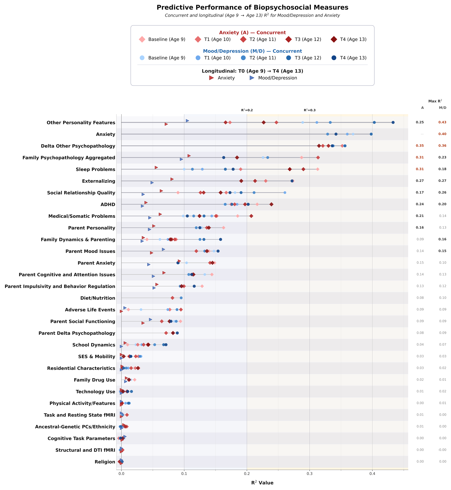
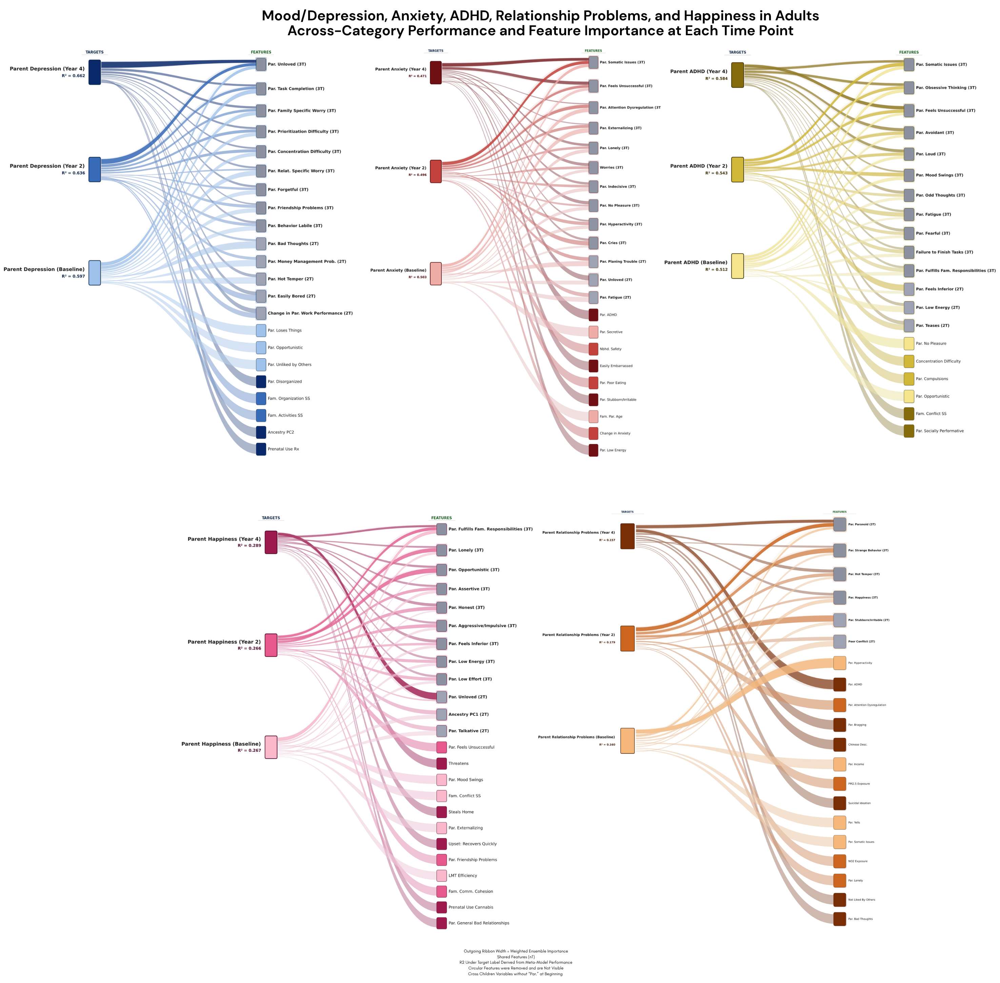

# ABCD Biopsychosocial Prediction

[](https://github.com/clarkmit/abcd-biopsychosocial-prediction/actions/workflows/ci.yml)
[](https://clarkmit.github.io/abcd-biopsychosocial-prediction)
[](https://doi.org/10.5281/zenodo.23540757)
[](pyproject.toml)
[](LICENSE)

High-dimensional ensemble stacking machine learning pipeline for hierarchical, interactive, and dynamic prediction of psychiatric, cognitive, and social outcomes in the ABCD Study.

Which of the wide range of currently available biopsychosocial measurements best predict hallmark psychiatric outcomes in adolescents and adults, and where do they converge or diverge in their predictive architecture? Full pipeline here organizes ~1,078 biopsychosocial variables extracted from the Adolescent Brain Cognitive Development (ABCD) Study, Release 5.1 (11,864 adolescents aged 9 to 14 and about 11,859 adult/parents), and uses a stacking machine learning ensemble to compare the hierarchical, interactive, concurrent, and prospective predictive capacities of a wide range of biological, psychological, social, and environmental measurement domains across multiple psychiatric and cognitive outcomes.

Repository contains analytic pipeline used in

> Roberts, C. et al. *Psychiatry and Its Hierarchical & Dynamic Discontents: Biopsychosocial Prediction in Depression, Anxiety, ADHD, Social Relationships, and Cognition.* Under review at *Nature*.



*Fig 5 of the article: within-category ensemble meta-model predictive performance (R²) for adolescent anxiety and hallmark low-mood/depression outcomes hierarchically compared using feature-engineered parcellated biopsychosocial measurement categories, at every available wave from age 9 to 13. Feature sets from age 9 were also used to prospectively predict age 13 outcomes.*



*Fig 7 of the article: full across-category ensemble performance (after circular features removed) showing top 15 consensus-weighted features for five adult targets at baseline, 2-year and 4-year follow-up. Ribbon width and opacity reflect weighted ensemble importance, and shared features are annotated (nT).*

## Quick-start

Requirements: Python 3.11 to 3.13. A laptop CPU is enough.

```bash
git clone https://github.com/clarkmit/abcd-biopsychosocial-prediction.git
cd abcd-biopsychosocial-prediction
python -m venv .venv && source .venv/bin/activate
pip install -e .
bpsp example-panel outputs/example_panel.csv   # simulated panel with a planted signal
bpsp run configs/demo.yaml                      # a minute or two
```

The run writes tables, figures and `run.log` to `outputs/demo/`. In `run.log`, the ensemble (`meta_model`) should reach a held-out R² of about 0.42 for `internal_D_p`, and the four planted predictors (Change in Unliked, Blames Others, Stubborn, Disagreeable) should head "Top Features by Weighted Consensus". The [quickstart notebook](notebooks/01_quickstart.ipynb) walks through the same run in Python, and [`02_full_analysis`](notebooks/02_full_analysis.ipynb) runs every stage. Both open in Colab.

## Feature sets and targets

Feature sets are organized for both across- and within-category analysis, using a diverse ontology of theoretically driven, commonly used, or potentially informative categories (37 for adolescents and 32 for parents over five waves, T0 to T4), matched to each wave's data acquisition scope/availability:

* Biological: multimodal neuroimaging (structural MRI morphometry, DTI, resting-state fMRI, task fMRI from MID, SST and N-back), ancestral genetic principal components, Fitbit-derived physical activity and physiology, pubertal and somatic measures.
* Psychological: experimental cognitive assessments (NIH Toolbox, Stop-Signal, N-back, MID, RAVLT, Little Man Task, Game of Dice) including hierarchical Bayesian individual-level PRAD parameters, personality traits, emotion regulation style, coextensive individual and familial psychopathology dimensions (CBCL, ASR, KSADS), sleep.
* Social: parenting styles, family dynamics and conflict, quality and dynamics of peer relationships, social discrimination and exclusion, parent social functioning.
* Environmental: adverse life events (child and parent report), residential characteristics and safety, neighborhood deprivation, school dynamics, cultural and religious factors, socioeconomic indicators.
* Temporal: delta (change-score) variables between adjacent available waves for theoretically relevant measures (other psychopathology, family conflict, social problems, adverse life events, school problems, grades), to assess the predictive utility of recent within-person change.

Several categories (multimodal neuroimaging, experimental tasks, Fitbit) were only collected in adolescents, and parent self-report was not collected at T1 or T3. Targets with circularity exclusions set up include:

* Hallmark psychiatric dimensions: depression, anxiety, ADHD, externalizing, internalizing and social problems (child CBCL and parent ASR), and many other more specific items such as impulsivity and compulsivity.
* Higher-order internalizing and externalizing spectra in children and parents across all available waves.
* Multiple depression operationalizations: dimensional syndrome and primary-features-only composites, top 5th and 10th percentile severity, Reliable Change Index (1.7, 1.96 and 2.3) and standardized-difference (1.5 and 2 SD) change classifications, and KSADS-derived symptom and diagnostic targets.
* 11 theoretically derived depression subtypes generated from permutations of CBCL items sharing the primary anhedonia/sadness core.
* Contrasting non-psychopathological outcomes: cognitive task performance, academic grades, weight, combined family income and technology use.

[Concepts](https://clarkmit.github.io/abcd-biopsychosocial-prediction/concepts/) explains the terms and lists the primary outcomes pre-specified in the article.

## Pipeline

A run is setup followed by any sequence of stages. Each stage is one module of `src/bpsp/` and one cell of the published notebook ([Stages](https://clarkmit.github.io/abcd-biopsychosocial-prediction/stages/)).

### Setup & Options

* Variable registry: the categorized feature sets for adolescents and parents at every wave, and the outcome lists.
* Circularity exclusions: a systematic per-target protocol removes tautological predictors (variables subsumed in the target), construct overlap that raters could plausibly conflate with the target, and plausible reverse-causation confounds. It is set up for all targets used in the paper and many more, in adolescents and parents, including possible intergenerational relationships.
* Objective/subjective gradient (optional): an alternative seven-level parcellation from classically more objective (genetic PCs, neuroimaging, cognitive tasks, Fitbit, physiological) to subjective (child self, parent self, parent-to-child, dyadic) measurement modalities.
* Preprocessing: variables more than 70% missing are dropped at each wave, the data are split 70/30 (stratified for classification) before anything is fitted, and k-nearest-neighbor imputation and scaling are fit exclusively on the training partition. Outliers are clipped at 5 SD, and constant and duplicate columns are removed.
* Natural language variable renaming: the analysis panel uses interpretable variable names (`data/variable_map.csv` gives each one's ABCD table and original name), and a display-name dictionary translates them into natural-language labels for figures.

### Modelling capacities 

* Stacking ensemble: CatBoost, XGBoost and random forest base learners, plus TabPFN in within-category runs (auto-excluded across categories, whose feature counts typically exceed TabPFN's recommended d ≤ 500 ceiling). A linear (regression) or logistic (classification) meta-learner is fit on the base learners' out-of-fold predictions, their pairwise products and their mean. The main hyperparameters are fixed a priori in one dictionary (`PIPELINE_MODEL_CONFIGS`).
* Runs: single targets or batch target bundles (for example "Child Dep Classification" or "F4: Depression & Anxiety Developmental Sweep"), any wave or all waves, concurrent or prospective prediction, within or across categories.
* Further options from the notebook, all off by default: subgroup filters (female, male, high or low adverse life events), single-category and category-combination runs, feature selection (RFECV, interaction, H-statistic or clustering), conformal prediction intervals, quantile-segmented predictions, a full grid of every wave, subgroup, target and split, and a hyperparameter search (not used for the article).

### Outputs and interpretation

* Weighted consensus feature importance across base learners and meta-model, and SHAP values for all base learners (or the best-performing model only), with partial dependence and GAM plots as an option.
* Within- and across-category feature importance plots, ROC, PR and calibration plots, and a summary table for classification batches.
* Sankey diagrams of the across-category feature-to-target architecture, with styles for the internalizing and externalizing spectra, developmental sweeps, depression worsening, severity thresholds and subtype trajectories.
* EBICglasso partial correlation networks, correlation matrices and dendrograms of the top 10 consensus features.
* Model diagnostics: model diversity, bootstrap stability, learning curves, SHAP beeswarm and effect sizes.

### Validation suite

The `smoke_test` stage is a quick end-to-end check of the fitted pipeline. The validation stages are:

| Stage | Check | Supplement |
|---|---|---|
| `nested_cv` | nested cross-validation (5 or 10 outer folds) with 95% confidence intervals, calibration and decision curves | S1.4, S1.11.3, S1.11.10 |
| `stratified` | extended demographic-stratified performance (child sex, parent sex, parent education, SES tertile, adverse life event exposure), 1,000 bootstraps | S1.17, S1.11.7 |
| `grouped_cv` | family- and site-grouped cross-validation, holding out whole families or sites | S1.5, S1.18.4 |
| `permutation` | permutation testing (1,000 permutations) with Phipson-Smyth correction | S1.4.4, S1.11.5 |
| `stacking_audit` | leakage checks: every row in exactly one inner validation fold, meta-learner fit only on out-of-fold predictions | S1.1 |
| `baselines` | PCA baseline comparisons and temporal hold-out generalization | S1.3, S1.6 |
| `ablation` | domain ablation and feature-domain importance | S1.19 |
| `trajectories` | cross-timepoint performance trajectories | S1.16.1 |
| `temporal_gradient` | temporal gradient, concurrent versus prospective decay | S1.16.2 |
| `fairness` | performance by race/ethnicity and religion, with partial correlation adjustment | S5.1 |
| `calibration` | calibration and Platt and isotonic recalibration | S5.2 |
| `base_learners` | each base learner against the stacked ensemble | S5.3 |
| `grouped_importance` | grouped permutation importance for correlated and change-based features | S5.4 |

[Methods in brief](https://clarkmit.github.io/abcd-biopsychosocial-prediction/methods/) gives the details, including the model each validation stage uses, and [Reproducing the paper](https://clarkmit.github.io/abcd-biopsychosocial-prediction/reproducing/) maps every figure and supplementary analysis to its stages and settings.

## With ABCD data

You need an approved ABCD Data Use Certification. Build the merged multi-wave panel with the extraction code in [abcd-visualizations-and-data](https://github.com/ra2yamamoto/abcd-visualizations-and-data), point `setup.DATA_PATH` at it (outside this repository), and run the stages for the results you want. Within-category runs use TabPFN, which needs a CUDA GPU (T4 or better, at least 10 GB of GPU memory). The article's analyses ran on an A100.

No ABCD data are included in this repository, and `.gitignore` rules, a pre-commit hook and CI stop data files and participant identifiers from being added ([Data access and governance](https://clarkmit.github.io/abcd-biopsychosocial-prediction/data/)).

## What's in the repository

| Folder | Contents |
|---|---|
| `paper/` | the exact code used for the article (v1.0.0, archived on [Zenodo](https://doi.org/10.5281/zenodo.23540757)), unchanged |
| `src/bpsp/` | the same pipeline as a Python package (v2): one module per notebook cell, a YAML configuration per run and a command-line interface |
| `notebooks/` | the quickstart (with its outputs) and a notebook that runs every stage |
| `configs/` | the demo, the CI check and every setting at its published default |
| `data/` | the fully simulated panel and the variable map, never ABCD data |
| `docs/` | the [documentation site](https://clarkmit.github.io/abcd-biopsychosocial-prediction) |
| `tests/` | unit, end-to-end, known-answer and equivalence tests |

The package is tested in CI on Python 3.11 to 3.13 and type-checked. Run side by side with v1.0.0 on simulated panels (with TabPFN replaced by a stand-in), it gives the same results at every stage. The few deliberate differences, such as reporting adjusted R² as missing where it is undefined, are listed with [the check](https://clarkmit.github.io/abcd-biopsychosocial-prediction/equivalence/).

## Limitations

Feature importance here describes predictive value and is exploratory, not causal. Many predictors and outcomes share raters and measurement methods, and shared rater and method variance remain central to interpretation. The circularity protocol reduces direct leakage but does not eliminate all rater, method, or ambiguous latent construct covariance. Models were developed and evaluated within ABCD only, and they are for population-level research, not for decisions about individuals ([model card](https://clarkmit.github.io/abcd-biopsychosocial-prediction/model_card/)). The demo and all automated tests use simulated data, so they check the software, not the article's findings ([Testing](https://clarkmit.github.io/abcd-biopsychosocial-prediction/testing/)). Issues kept from v1.0.0 are listed in [Known issues](https://clarkmit.github.io/abcd-biopsychosocial-prediction/known_issues/).

## Citation

Please cite the article and the software. [`CITATION.cff`](CITATION.cff) has the details, and GitHub's "Cite this repository" button uses it. The version used for the article is v1.0.0, DOI [10.5281/zenodo.23540757](https://doi.org/10.5281/zenodo.23540757).

## Contributors

Clark Roberts (conceptualization, feature-engineering, ML pipeline programming, implementation of manuscript models, statistical analysis, visualization), Zhafira E. Fawnia (Ensemble ML programming). Contributions are welcome (see [CONTRIBUTING.md](CONTRIBUTING.md)).

## Acknowledgments

Data used in the preparation of the article and the figures shown here were obtained from the Adolescent Brain Cognitive Development (ABCD) Study (https://abcdstudy.org), held in the NIMH Data Archive (NDA). This is a multisite, longitudinal study designed to recruit more than 10,000 children age 9-10 and follow them over 10 years into early adulthood. The ABCD Study is supported by the National Institutes of Health and additional federal partners under award numbers U01DA041048, U01DA050989, U01DA051016, U01DA041022, U01DA051018, U01DA051037, U01DA050987, U01DA041174, U01DA041106, U01DA041117, U01DA041028, U01DA041134, U01DA050988, U01DA051039, U01DA041156, U01DA041025, U01DA041120, U01DA051038, U01DA041148, U01DA041093, U01DA041089, U24DA041123, U24DA041147. A full list of supporters is available at https://abcdstudy.org/federal-partners.html. A listing of participating sites and a complete listing of the study investigators can be found at https://abcdstudy.org/consortium_members/. ABCD consortium investigators designed and implemented the study and/or provided data but did not necessarily participate in the analysis or writing of this report. This manuscript reflects the views of the authors and may not reflect the opinions or views of the NIH or ABCD consortium investigators. ABCD DOI: https://doi.org/10.15154/abt7-2i22

## License and contact

This code is released under the [MIT License](LICENSE). Use of the ABCD dataset itself is governed by the ABCD Data Use Certification. For questions about the code, please contact Clark Roberts (Clark001@mit.edu). For questions about data access, please consult the [NBDC Data Hub](https://www.nbdc-datahub.org).
