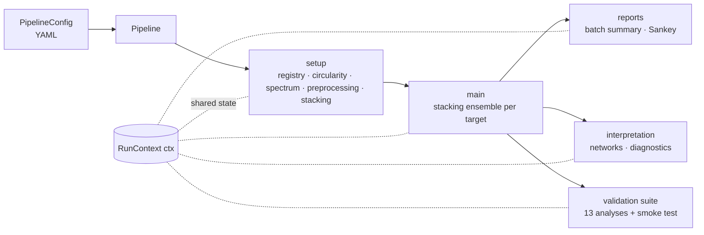

# Architecture

## From notebook to package

The pipeline was written and used for the paper as a 25-cell Colab notebook (about 38,000 lines), frozen as release v1.0.0 in `paper/`. Version 2 turns it into an installable package with the same results, apart from the few deliberate changes listed in [Equivalence](equivalence.md).

Results of the published notebook were recorded on a simulated panel before anything changed, and every step of the conversion was checked against them. Notebook cells became modules, Colab form fields became typed configuration, and the global namespace the cells shared became one explicit run context.

The conversion itself was done with a syntax-tree codemod (libcst) that keeps the code as written, so each module still reads like its notebook cell. Formatting (ruff), the switch from `print` to logging and the later tidying of comments were each checked to leave every module's syntax tree unchanged apart from the logging calls. The conversion tooling was used once and is not part of this repository. From v2.0.0 on, the package is the source and is edited directly.



## Package layout

```text
src/bpsp/
├── __init__.py          public API: Pipeline, PipelineConfig, ctx, configure_logging
├── pipeline.py          orchestration: setup, stage order, working directory, timings
├── config.py            typed configuration for every stage (YAML in and out, validation)
├── context.py           RunContext: the explicit shared state of a session
├── cli.py               `bpsp run | stages | init-config | example-panel`
├── simulation.py        simulated panel with a known signal (demo and tests)
├── _logging.py          console/file logging
├── reporting.py         report state and cache hooks              (cell 0)
├── data/
│   ├── registry.py      variable registry, outcome lists          (cell 1)
│   ├── circularity.py   per-target circularity exclusions         (cell 2)
│   ├── spectrum.py      objective/subjective ontology, optional   (cell 3)
│   └── preprocessing.py loading, task detection, splits           (cell 4)
├── models/
│   └── stacking.py      StackingEnsembleModel, hyperparameters    (cell 5)
├── analysis/
│   └── runner.py        main analysis runner, batch mode          (cell 6)
├── reports/             batch summary, Sankey                     (cells 7-8)
├── interpretation/      feature networks, model diagnostics       (cells 9-10)
└── validation/          smoke test and 13 validation analyses     (cells 11-24)
```

## The run context

In the notebook every cell read and wrote one global namespace: the main runner left `X_train`, `metrics_dict_full` or `_batch_archive` behind, and validation cells picked them up. In the package that namespace is a single object, `bpsp.ctx` (a `RunContext`, which is a dict with attribute access):

* stage settings are written into it before each stage runs, exactly when the notebook cell would have set its form fields
* stages read their inputs from it and write their outputs to it, so `ctx.X_train` or `ctx.metrics_dict_full` can be inspected after any stage
* `Pipeline.setup()` resets it, so every session starts clean

Shared names are written as `ctx.<name>` in the code, so every cross-stage dependency is visible with a text search, and each stage's inputs and outputs are listed in [Stage data flow](#stage-data-flow) below.

Rewriting every function to take its inputs as arguments would have meant re-deriving the behavior of 38,000 lines by hand. The run context gives the same visibility while keeping the verified behavior. With the equivalence tests in place, individual stages can now be refactored into pure functions one at a time.

The stacking model keeps one more notebook pattern. `StackingEnsembleModel` gets its final `fit`, `predict` and `predict_proba` methods from `enhance_stacking_ensemble_model()` in `bpsp.models.stacking`, which v1.0.0 used to add the interaction meta-features (pairwise products and mean) to the class after defining it. It is kept as written so that the fitted models stay identical.

## Code quality

The hand-written modules (`pipeline`, `config`, `context`, `cli`, `_logging`, `simulation`) are fully type-annotated and checked with mypy, and have 94% unit-test coverage. The stage modules keep the notebook's code and style and are checked by the integration and equivalence tests, and by ruff with a few rules relaxed for them (listed in `pyproject.toml`).

## Configuration

Each notebook form field became a typed field of a stage dataclass in `bpsp.config`, with the published value as default and the notebook's drop-down options as allowed values. `PipelineConfig` combines them with the list of stages, the output directory and optional model hyperparameter overrides, and reads and writes YAML. Invalid stage names, unknown settings and out-of-range choices fail fast with a clear message.

## Logging and outputs

Stage output goes through the `bpsp` logger. The default console handler prints messages unformatted to the current `sys.stdout`, which reproduces the notebook's printed output in Jupyter and in a terminal. Styled tables and HTML notes are shown with IPython's `display`, so they render in Jupyter and Colab. `bpsp run` prints them as plain text instead. The command line also saves everything the console shows to `run.log`, plus the resolved configuration, next to the tables and figures in the output directory.

## Optional dependencies

TabPFN and PyTorch are an optional extra. Without them the package runs on CPU and TabPFN is left out of the ensemble, as the notebook already did for across-category runs.

## Stage data flow

--8<-- "docs/_generated/dataflow.md"
