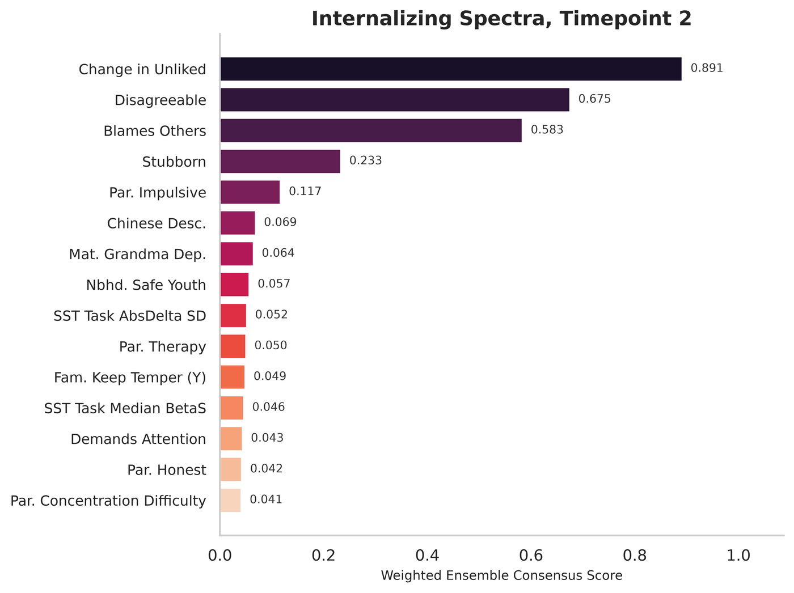

# Quickstart

The repository ships a fully simulated panel (`data/simulated/`) with the same columns and five-wave structure as the analysis file. Its columns are drawn independently, so nothing in it is predictable. `bpsp example-panel` resamples it and plants a known signal at wave T2 in four predictors (`bpsp.simulation`), which gives the demo a correct answer to recover.

## Command line

```bash
bpsp example-panel outputs/example_panel.csv
bpsp run configs/demo.yaml
```

This runs setup (registry, circularity exclusions, preprocessing, model configuration) and the stages listed in the config, writing tables, figures, `run.log` and the resolved configuration to `outputs/demo/`. In `run.log`, the ensemble's held-out R² for `internal_D_p` should be about 0.42, and the four planted predictors (Change in Unliked, Blames Others, Stubborn, Disagreeable) should head "Top Features by Weighted Consensus".



*Weighted consensus feature importance from the quickstart notebook, on a simulated panel in which four predictors carry the signal. The pipeline ranks them first. Simulated data, not a result of the article.*

Two warnings near the start are expected with the simulated panel. It lacks 24 variables that the registry lists, mostly parent self-report items ("columns were not found in the dataset and have been dropped"), and some of its columns are more than 70% missing at T2, so they are dropped (the message says "Dropped columns at t = 2 due to entirely missing data"). The adjusted R² column of the metrics table is empty in the demo, because the demo has fewer test rows than predictors (see [Methods in brief](methods.md)).

Run other stages, or override the output directory:

```bash
bpsp run configs/demo.yaml --stages main,networks,base_learners --output-dir outputs/try2
bpsp stages                     # list every stage
bpsp init-config my_run.yaml    # a config file with every setting at its published default
```

## Python

```python
from bpsp import Pipeline, PipelineConfig, ctx

cfg = PipelineConfig.from_yaml("configs/demo.yaml")
cfg.main.target_options = "internal_D_p"
cfg.main.split = "across_categories"
cfg.main.tp_option = "2"

pipe = Pipeline(cfg)
pipe.run(["main", "base_learners"])

ctx.metrics_dict_full  # held-out metrics per base learner and the ensemble
ctx.consensus_df  # consensus feature importance
ctx.X_train.shape  # the exact training matrix used
pipe.timings  # seconds per stage
```

Stages can also be run one at a time, which mirrors running notebook cells:

```python
pipe = Pipeline(cfg)
pipe.setup()
pipe.run_stage("main")
pipe.run_stage("nested_cv")
```

## With ABCD data

1. Obtain ABCD data under an approved Data Use Certification (see [Data access](data.md)). The article used Release 5.1.
2. Build the merged multi-wave panel with the extraction code in [abcd-visualizations-and-data](https://github.com/ra2yamamoto/abcd-visualizations-and-data).
3. Point `setup.DATA_PATH` at that file (outside this repository) and choose stages and targets in a config file.
